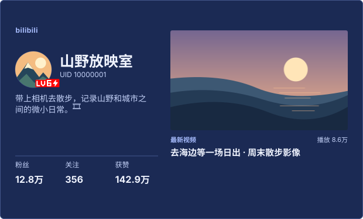

# Bili Card

用一个 B 站 UID 生成 SVG 名片，嵌入 GitHub README、博客或作品集。

[打开卡片生成器](https://bili-card.130923.xyz/) · [API 目录](https://bili-card.130923.xyz/api?action=list) · [反馈问题](https://github.com/lsqkk/bili-card/issues)



## 快速开始

在 B 站个人空间 URL 中找到 UID，例如 `https://space.bilibili.com/2105459088`。在生成器中预览并复制 Markdown、HTML 或图片地址，也可以直接修改下面的链接。

```md
[](https://space.bilibili.com/2105459088)
```

## 布局和配色

| 主题 | 使用场景 | 示例 |
| --- | --- | --- |
| `default` 经典 | 横向资料和视频 | [示例](https://bili-card.130923.xyz/api/card?demo=true&theme=default&color=blue) |
| `modern` 聚焦 | 作品集，大封面突出最新作品 | [示例](https://bili-card.130923.xyz/api/card?demo=true&theme=modern&color=cobalt) |
| `btv` 小电视 | 个人空间、社区主页 | [示例](https://bili-card.130923.xyz/api/card?demo=true&theme=btv&color=pink) |
| `simple` 极简 | README、作者信息 | [示例](https://bili-card.130923.xyz/api/card?demo=true&theme=simple&color=green) |
| `poster` 海报 | 竖向作品推荐，无作品时自动收起封面区 | [示例](https://bili-card.130923.xyz/api/card?demo=true&theme=poster&color=sand) |
| `banner` 横幅 | 窄栏或页眉 | [示例](https://bili-card.130923.xyz/api/card?demo=true&theme=banner&color=teal) |

浅色支持 `white`、`blue`、`pink`、`green`、`purple`、`sand`，深色支持 `dark`、`cobalt`、`teal`。选择 `auto` 后，支持配色媒体查询的宿主会根据系统偏好切换。

## API

### `GET /api/card`

返回 `image/svg+xml`。参数均通过查询字符串传入。

| 参数 | 取值和默认行为 |
| --- | --- |
| `uid` | B 站正整数 UID。开启示例模式时可省略 |
| `theme` | 主题 ID，默认 `default` |
| `color` | 配色 ID，默认 `white` |
| `width` | 按比例调整输出尺寸，支持 160–2400 px，省略时使用主题原始尺寸 |
| `hide` | 逗号分隔的模块 ID，支持 `avatar,sign,uid,level,follower,following,like,video` |
| `hideVideo` | `true` 隐藏视频，兼容旧链接 |
| `video` | `latest` 按发布时间（默认），或 `popular` 按播放数 |
| `lang` | `zh-CN`（默认）或 `en`，控制卡片标签和数字单位 |
| `number` | `compact` 简写（默认），或 `full` 完整数值 |
| `bg` | `solid`（默认），或 `transparent` 去掉外底板。小电视保留机身轮廓 |
| `accent` | 自定义强调色，填写六位十六进制值，例如 `3B66D9` |
| `motion` | `true` 开启入场动画，遵循减少动态效果偏好 |
| `animated` | `true` 时尝试保留上游 GIF 动画，受 SVG 宿主支持影响 |
| `cache` | 浏览器与 CDN 缓存秒数，0–3600，默认 3600。0 禁用 HTTP 响应缓存 |
| `demo` | `true` 使用内置虚构资料，无需访问上游 |

`simple` 和 `banner` 只展示个人资料。未知主题或配色回退到默认值。UID 无效、用户不存在、请求过多或资料暂时不可用时，返回相应的 400、404、429 或 502 和一张错误 SVG。

### 其他端点

- `GET /api?action=list` 返回主题、色板、可隐藏模块和参数说明。可加 `type=themes` 或 `type=colors`。另支持 `action=details&id=poster` 和 `action=preview&theme=poster&color=teal`。
- `GET /api/data?uid=2105459088` 返回同一资料源的 JSON。支持 `hideVideo=true` 和 `video=popular`。资料降级时响应包含 `partial: true`，原有数值字段以 0 补齐。
- `GET /api/health` 返回实例状态。

头像、封面以数据 URI 内嵌，可直接通过 `` 或 Markdown 使用。投稿接口异常时仍可显示用户资料，短缓存后重试。

## 本地开发与部署

使用 Node.js 22，项目无第三方运行时依赖。

```bash
npm run dev
npm test
```

打开 `http://localhost:3000/`。在 Vercel 导入仓库后使用 Other 框架预设，`vercel.json` 声明静态目录和 API 路由。可用 `npm run dev:vercel` 在本地运行 Vercel CLI，或用 `npm run deploy` 部署已关联的项目。

图片默认通过 weserv 处理，可用 `IMAGE_PROXY_DISABLED=true` 直连 B 站图片 CDN，或设置含 `{url}` 的 `IMAGE_PROXY_URL`。资料优先使用 B 站公开资料接口，备用资料与投稿来自 [UAPI](https://uapis.cn/docs/api-reference/get-social-bilibili-archives)。

[贡献指南](CONTRIBUTING.md) · [MIT 许可证](LICENSE)
